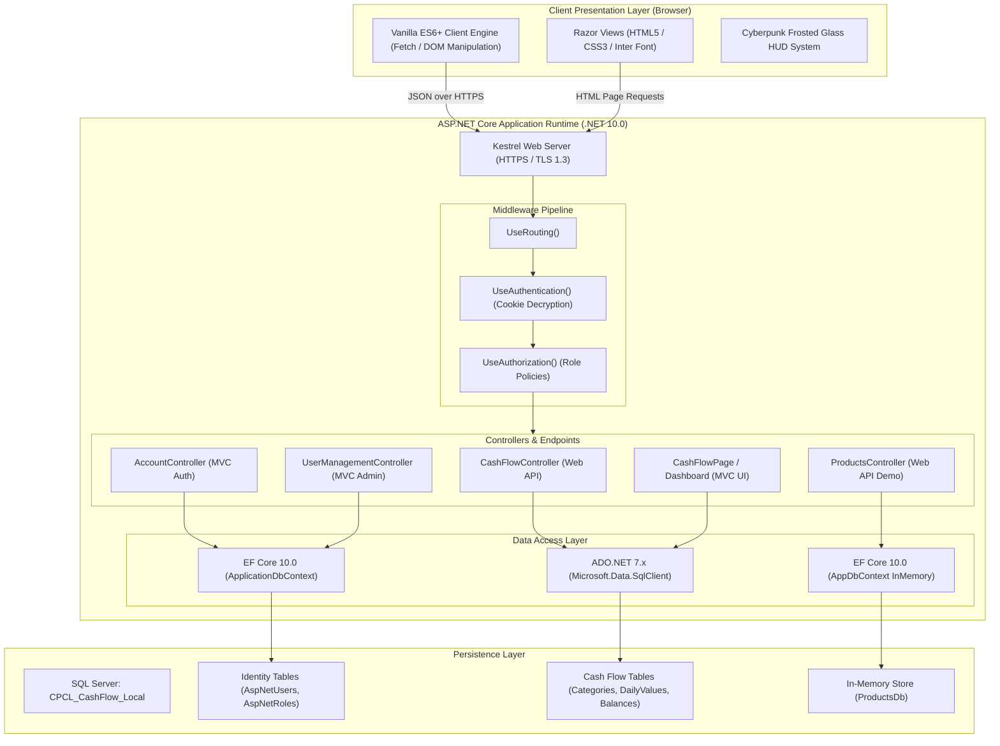
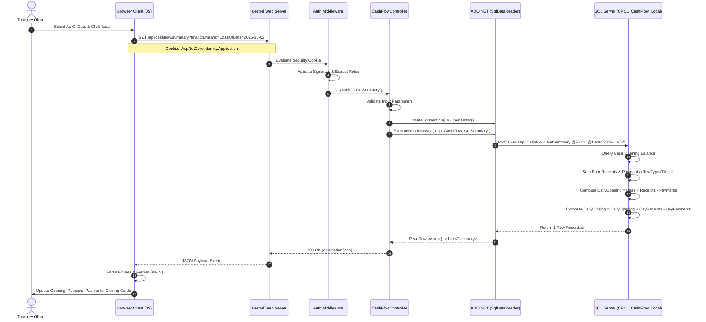
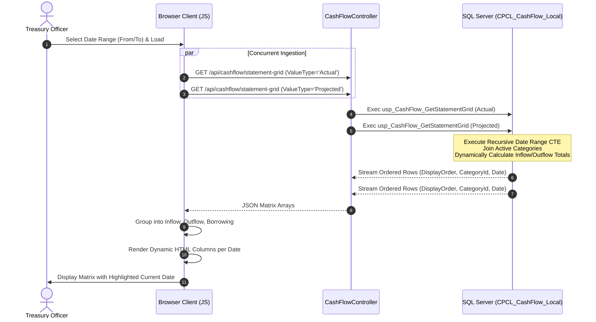
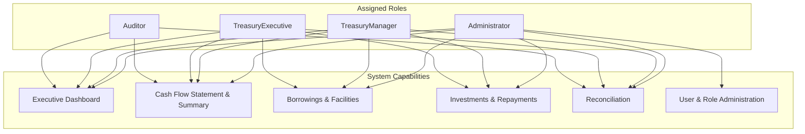

# CPCL TREASURY MANAGEMENT SYSTEM
## Enterprise API Architecture & Backend Technical Specification

---

### Document Control & Metadata

| Property | Value |
| :--- | :--- |
| **Document Title** | CPCL Treasury Management System — API Architecture & Backend Technical Specification |
| **System Name** | CPCL Treasury Management System (`DotNetMvcTest`) |
| **Document Version** | 1.0.0 (Production Architecture Audit) |
| **Classification** | Internal Technical Documentation / Restricted |
| **Target Runtime** | .NET 10.0 (`net10.0`), ASP.NET Core Kestrel Web Server |
| **Primary Database** | Microsoft SQL Server (`CPCL_CashFlow_Local` / `CPCL_CashFlow_Test`) |
| **Secondary Database** | Entity Framework Core InMemory Database (`ProductsDb`) |
| **Document Purpose** | Comprehensive architectural, API, security, and database execution specification |
| **Audience** | Software Architects, Full-Stack Engineers, DevOps/SecOps, Financial Systems Auditors |
| **Author / Auditor** | Senior ASP.NET Core API Architect & Application Security Specialist |

---

## TABLE OF CONTENTS

1. [Executive Summary & System Overview](#1-executive-summary--system-overview)
2. [Project Inventory & Component Classification](#2-project-inventory--component-classification)
3. [API & HTTP Fundamentals in CPCL Treasury](#3-api--http-fundamentals-in-cpcl-treasury)
4. [End-to-End Application Request Lifecycle](#4-end-to-end-application-request-lifecycle)
5. [Complete Endpoint Reference & Data Contracts](#5-complete-endpoint-reference--data-contracts)
6. [In-Depth Cash Flow API Walkthrough](#6-in-depth-cash-flow-api-walkthrough)
7. [Stored Procedure Technical Specification](#7-stored-procedure-technical-specification)
8. [Controllers, Services & Dual-Data Access Architecture](#8-controllers-services--dual-data-access-architecture)
9. [Role-Based Access Control (RBAC) & Security Architecture](#9-role-based-access-control-rbac--security-architecture)
10. [Database Architecture & Financial Data Flow](#10-database-architecture--financial-data-flow)
11. [Error Handling, Validation & Production Troubleshooting](#11-error-handling-validation--production-troubleshooting)
12. [API Testing, Verification & Integration Guide](#12-api-testing-verification--integration-guide)
13. [Advanced Technical Implementation Details](#13-advanced-technical-implementation-details)
14. [Architectural Visualizations (Mermaid Diagrams)](#14-architectural-visualizations-mermaid-diagrams)
15. [Known Limitations, Security Gaps & Strategic Roadmap](#15-known-limitations-security-gaps--strategic-roadmap)
16. [Technical & Treasury Financial Glossary](#16-technical--treasury-financial-glossary)

---

## 1. EXECUTIVE SUMMARY & SYSTEM OVERVIEW

The **CPCL Treasury Management System** (internal code artifact `DotNetMvcTest`) is a mission-critical enterprise financial management platform engineered for Chennai Petroleum Corporation Limited (CPCL). The application is designed to ingest, monitor, forecast, and reconcile daily liquidity positions, cash inflows, cash outflows, borrowings, and commercial credit facilities.

```
       +-------------------------------------------------------+
       |               CPCL Treasury Management                |
       |                   System Architecture                 |
       +-------------------------------------------------------+
                                   |
         +-------------------------+-------------------------+
         |                                                   |
+------------------+                               +------------------+
|  ASP.NET Core    |                               |  ASP.NET Core    |
|  MVC Controllers |                               |  Web API / REST  |
|  (Razor Views)   |                               |  Controllers     |
+------------------+                               +------------------+
         |                                                   |
         | (Auth Cookie / Antiforgery)                       | (JSON / HTTP)
         v                                                   v
+------------------+                               +------------------+
| EF Core Identity |                               | Raw ADO.NET 7.x  |
| (SQL Server)     |                               | (Direct SPs)     |
+------------------+                               +------------------+
         |                                                   |
         +-------------------------+-------------------------+
                                   |
                                   v
             +-------------------------------------------+
             |            Microsoft SQL Server           |
             |           (CPCL_CashFlow_Local)           |
             +-------------------------------------------+
```

### 1.1 Core Business Mission
CPCL operates massive daily capital flows spanning crude procurement (IOC, ONGC, CBR), refined product sales across terminals and Oil Marketing Companies (OMCs), excise duty, GST, payroll, and debt servicing. The primary objective of the Cash Flow engine is to calculate and track:
1. **Daily Opening Balance**: Continuous cumulative liquidity brought forward from the start of the financial year.
2. **Cash Inflows**: Operational sales receipts, short-term borrowings, commercial papers, foreign currency loans, and investment maturities.
3. **Cash Outflows**: Crude payments, statutory taxes, operational expenditure, capital projects, debt repayments, interest, and dividends.
4. **Daily Closing Balance**: The exact liquidity closing position defined by the fundamental accounting equation:
   $$\text{Closing Balance} = \text{Opening Balance} + \text{Receipts} - \text{Payments}$$
5. **Credit Facilities & Borrowings**: Gross debt monitoring, State Bank of India (SBI) credit line utilization, short-term rupee/FC borrowings, commercial papers, and the Borrowing-to-Net-Worth leverage ratio.

### 1.2 Technology Stack Verified from Source Code
- **Language & Framework**: C# 13 / .NET 10.0 (`net10.0`), utilizing ASP.NET Core Web App runtime.
- **Web UI & Rendering**: Razor Views with tag helpers, vanilla JavaScript (ES6+), CSS3 with glassmorphic cyberpunk HUD themes, FontAwesome 6.7.2, Bootstrap 5.3, and Google Fonts (*Inter* and *JetBrains Mono*).
- **Data Access Layer (Hybrid)**:
  - *ADO.NET 7.x (`Microsoft.Data.SqlClient 7.1.1`)*: Used exclusively for all high-performance Cash Flow financial operations, stored procedure execution, and dynamic aggregation.
  - *Entity Framework Core 10.0.13 (`Microsoft.EntityFrameworkCore.SqlServer`)*: Used exclusively for ASP.NET Core Identity authentication, role management, user claims, and security stamps.
  - *EF Core InMemory Provider (`Microsoft.EntityFrameworkCore.InMemory`)*: Isolated mock store for legacy product catalog demonstration endpoints (`ProductsDb`).
- **Security & Identity**: ASP.NET Core Identity with role-based authorization (`Administrator`, `TreasuryManager`, `TreasuryExecutive`, `Auditor`), cryptographic password hashing (PBKDF2), HTTP-only sliding session cookies, and lockout protection.
- **API Documentation**: OpenAPI / Swagger via `Swashbuckle.AspNetCore 10.3.0`.

---

## 2. PROJECT INVENTORY & COMPONENT CLASSIFICATION

A source-code audit across the solution directory `d:\Treasury\DotNetMvcTest - Anti` identified all physical files, configuration blocks, controllers, models, and database scripts.

### 2.1 Solution & Project Structure
- Project File: [`DotNetMvcTest.csproj`](file:///d:/Treasury/DotNetMvcTest%20-%20Anti/DotNetMvcTest.csproj)
  - Target Framework: `net10.0`
  - Nullable Reference Types: `enable`
  - Implicit Usings: `enable`
  - User Secrets ID: `6ce866c4-b07d-446c-a793-1ed4aea9e9d6`
- Application Entry Point: [`Program.cs`](file:///d:/Treasury/DotNetMvcTest%20-%20Anti/Program.cs) (209 lines)
  - Configures logging, database connection strings, Swagger, controllers with views, EF Core contexts, Identity policies, cookie settings, and HTTP middleware pipeline.
- Configuration Files:
  - [`appsettings.json`](file:///d:/Treasury/DotNetMvcTest%20-%20Anti/appsettings.json): Defines connection string `CashFlowDb` pointing to `CPCL_CashFlow_Local`.
  - [`appsettings.Development.json`](file:///d:/Treasury/DotNetMvcTest%20-%20Anti/appsettings.Development.json): Development environment overrides.

### 2.2 Controller Inventory
The project implements **10 C# Controller classes** and **2 Minimal API endpoints**, spanning **25 distinct HTTP endpoints**:

| Controller Class | File Location | Base Class | Architecture Type | Purpose & Status |
| :--- | :--- | :--- | :--- | :--- |
| **`CashFlowController`** | [`Controllers/CashFlowController.cs`](file:///d:/Treasury/DotNetMvcTest%20-%20Anti/Controllers/CashFlowController.cs) | `ControllerBase` | Web API (`[ApiController]`) | **Core Engine**: 5 GET endpoints querying SQL Server stored procedures via ADO.NET. Fully implemented. |
| **`ProductsController`** | [`Controllers/ProductsController.cs`](file:///d:/Treasury/DotNetMvcTest%20-%20Anti/Controllers/ProductsController.cs) | `ControllerBase` | Web API (`[ApiController]`) | Demo CRUD API: 5 endpoints backed by EF Core InMemory `AppDbContext`. Working demo. |
| **`AccountController`** | [`Controllers/AccountController.cs`](file:///d:/Treasury/DotNetMvcTest%20-%20Anti/Controllers/AccountController.cs) | `Controller` | MVC Controller | Identity Auth: Login, Logout, and AccessDenied actions. Fully implemented. |
| **`CashFlowPageController`**| [`Controllers/CashFlowPageController.cs`](file:///d:/Treasury/DotNetMvcTest%20-%20Anti/Controllers/CashFlowPageController.cs)| `Controller` | MVC Controller | Host controller rendering the interactive Cash Flow Statement Razor view. Fully implemented. |
| **`DashboardController`** | [`Controllers/DashboardController.cs`](file:///d:/Treasury/DotNetMvcTest%20-%20Anti/Controllers/DashboardController.cs) | `Controller` | MVC Controller | Post-login executive landing dashboard. Fully implemented. |
| **`UserManagementController`**| [`Controllers/UserManagementController.cs`](file:///d:/Treasury/DotNetMvcTest%20-%20Anti/Controllers/UserManagementController.cs)| `Controller`| MVC Controller | Admin-only user and role inspection screen. Read-only implementation. |
| **`HomeController`** | [`Controllers/HomeController.cs`](file:///d:/Treasury/DotNetMvcTest%20-%20Anti/Controllers/HomeController.cs) | `Controller` | MVC Controller | Root redirection to Dashboard, Privacy, and global error handling. Fully implemented. |
| **`BorrowingsController`** | [`Controllers/PlaceholderControllers.cs`](file:///d:/Treasury/DotNetMvcTest%20-%20Anti/Controllers/PlaceholderControllers.cs)| `Controller` | MVC Controller | **Placeholder**: Borrowings & facilities module. Returns empty view. |
| **`InvestmentsController`**| [`Controllers/PlaceholderControllers.cs`](file:///d:/Treasury/DotNetMvcTest%20-%20Anti/Controllers/PlaceholderControllers.cs)| `Controller` | MVC Controller | **Placeholder**: Investments & repayments module. Returns empty view. |
| **`ReconciliationController`**|[`Controllers/PlaceholderControllers.cs`](file:///d:/Treasury/DotNetMvcTest%20-%20Anti/Controllers/PlaceholderControllers.cs)| `Controller` | MVC Controller | **Placeholder**: Bank ledger reconciliation module. Returns empty view. |
| **Minimal API Routes** | [`Program.cs`](file:///d:/Treasury/DotNetMvcTest%20-%20Anti/Program.cs#L84-L154) | N/A | Minimal API | Connectivity test (`/api/cashflow/test-connection`) & framework ping (`/api/test`). |

### 2.3 Models, ViewModels & Entity Classes
- [`Models/Product.cs`](file:///d:/Treasury/DotNetMvcTest%20-%20Anti/Models/Product.cs): Entity model representing catalogue items (`Id`, `Name`, `Price`) with validation attributes.
- [`Models/LoginViewModel.cs`](file:///d:/Treasury/DotNetMvcTest%20-%20Anti/Models/LoginViewModel.cs): Request model for user authentication (`Email`, `Password`, `RememberMe`, `ReturnUrl`).
- [`Models/ErrorViewModel.cs`](file:///d:/Treasury/DotNetMvcTest%20-%20Anti/Models/ErrorViewModel.cs): View model capturing diagnostic request IDs for unhandled exceptions (`RequestId`, `ShowRequestId`).

### 2.4 Data Contexts & Services
- [`Data/ApplicationDbContext.cs`](file:///d:/Treasury/DotNetMvcTest%20-%20Anti/Data/ApplicationDbContext.cs): EF Core DbContext inheriting from `IdentityDbContext<IdentityUser>`. Manages tables `AspNetUsers`, `AspNetRoles`, `AspNetUserRoles`, `AspNetUserClaims`, `AspNetUserLogins`, `AspNetRoleClaims`, and `AspNetUserTokens`.
- [`Data/DbContext.cs`](file:///d:/Treasury/DotNetMvcTest%20-%20Anti/Data/DbContext.cs): EF Core `AppDbContext` managing `DbSet<Product> Products` in InMemory storage.
- [`Services/IdentitySeeder.cs`](file:///d:/Treasury/DotNetMvcTest%20-%20Anti/Services/IdentitySeeder.cs): Idempotent startup service that creates mandatory roles (`Administrator`, `TreasuryManager`, `TreasuryExecutive`, `Auditor`) and seeds initial administrative credentials from configuration keys `AdminSeed:Email` and `AdminSeed:Password`.

### 2.5 Database Scripts & Migration Artifacts
- [`update_procs_task1.sql`](file:///d:/Treasury/DotNetMvcTest%20-%20Anti/update_procs_task1.sql): Production definitions for stored procedures `dbo.usp_CashFlow_GetCategories`, `dbo.usp_CashFlow_GetStatementGrid`, and `dbo.usp_CashFlow_GetSummary`.
- [`seed_task1.sql`](file:///d:/Treasury/DotNetMvcTest%20-%20Anti/seed_task1.sql): Comprehensive seeding script provisioning 60 categories, initial opening balances (33.5510 ₹ Cr), and baseline daily values for FY 2026–27.
- [`Migrations/20261021041749_AddIdentityTables.cs`](file:///d:/Treasury/DotNetMvcTest%20-%20Anti/Migrations/20261021041749_AddIdentityTables.cs): EF Core SQL Server migration creating all ASP.NET Core Identity schemas.

---

## 3. API & HTTP FUNDAMENTALS IN CPCL TREASURY

Understanding the communication between the user's web browser and the ASP.NET Core backend requires dissecting the foundational networking and protocol concepts underpinning modern enterprise applications.

### 3.1 What is an API and Why Does CPCL Treasury Use It?
An **Application Programming Interface (API)** is a standardized set of rules, protocols, and data contracts that enables software programs to communicate with one another.

In traditional monolithic web development (early ASP.NET Web Forms or classic MVC), every user action triggers a full page reload: the browser asks the server for HTML, the server executes SQL, constructs an entire HTML document, and returns it to the browser. If a user changes a filter date, the entire window flashes white while all styles, scripts, and navigation chrome are re-downloaded.

In the CPCL Treasury Management System, APIs are leveraged to achieve a **decoupled, reactive user experience**:
- The browser loads the visual shell (HTML, navigation cards, headers, stylesheets) once via an MVC Controller action.
- The browser’s JavaScript client then executes asynchronous, non-blocking HTTP requests to the **Web API endpoints** (e.g., `/api/cashflow/summary` and `/api/cashflow/statement-grid`).
- The Web API queries SQL Server, serializes only the raw numerical and structural records into lightweight JSON, and returns it.
- Client-side JavaScript updates only the specific table rows and summary balance numbers in the Document Object Model (DOM) dynamically.

### 3.2 HTTP and Transport Security (HTTPS)
**HTTP (Hypertext Transfer Protocol)** is an application-layer, stateless request-response protocol operating over TCP/IP. The client sends an HTTP request message, and the server processes it and returns an HTTP response message.

**HTTPS (HTTP Secure)** encrypts this entire conversation using Transport Layer Security (TLS/SSL). In financial treasury applications, HTTPS is legally and operationally mandatory:
- Prevents packet-sniffing of corporate cash balances, banking loan amounts, and crude oil payments.
- Protects user authentication session cookies (`.AspNetCore.Identity.Application`) from being intercepted via man-in-the-middle (MitM) attacks.
- Enforced in `Program.cs` via `app.UseHttpsRedirection()` and `app.UseHsts()` (HTTP Strict Transport Security in production).

### 3.3 HTTP Request Methods in this System
The HTTP specification defines specific methods (verbs) denoting the action to be performed:

| HTTP Method | Architectural Semantic | Usage in CPCL Treasury Source Code |
| :--- | :--- | :--- |
| **`GET`** | Safe and idempotent data retrieval. Must never mutate server state. | Used in `CashFlowController` (`categories`, `summary`, `statement-grid`, `transactions`, `projected-amounts`), `ProductsController.GetAll`, and all MVC page renders. |
| **`POST`** | Non-idempotent resource creation or secure action processing. | Used in `ProductsController.Create` to insert products; used in `AccountController.Login` and `AccountController.Logout` to post credential forms. |
| **`PUT`** | Idempotent complete replacement of an existing resource. | Used in `ProductsController.Update` to replace an existing product's attributes. |
| **`DELETE`** | Idempotent deletion of a specified resource. | Used in `ProductsController.Delete` to remove catalogue entities from InMemory storage. |
| **`PATCH`** | Partial modification of a resource. | *Not implemented in this project.* |

### 3.4 URL Anatomy, Routing, and Parameter Binding
An HTTP request URL informs ASP.NET Core routing where to direct the incoming request. Consider an actual call executed by the Treasury frontend:

$$\text{https://localhost:7185/api/cashflow/statement-grid?financialYearId=1\&fromDate=2026-10-02\&toDate=2026-10-08\&valueType=Actual}$$

```
https://localhost:7185 /api/cashflow/statement-grid ?financialYearId=1&fromDate=2026-10-02...
[Scheme] [Host:Port]   [Route / Path Template]      [Query String Parameters]
```

1. **Scheme (`https://`)**: Indicates encrypted TLS communication.
2. **Authority / Host (`localhost:7185`)**: Network address and port where Kestrel listens.
3. **Path / Route Template (`/api/cashflow/statement-grid`)**: Matches the controller routing defined by `[Route("api/cashflow")]` on `CashFlowController` and `[HttpGet("statement-grid")]` on the action method.
4. **Query String (`?...`)**: Key-value pairs separated by `&`:
   - `financialYearId=1`: Primary key referencing `dbo.CashFlowFinancialYears`.
   - `fromDate=2026-10-02`: Beginning of the reporting period.
   - `toDate=2026-10-08`: End of the reporting period.
   - `valueType=Actual`: Discriminator selecting actual ledger transactions vs projected numbers.
5. **Route Parameters**: Parameters embedded directly within the URL path, such as `/api/products/{id:int}` in `ProductsController.GetById(int id)`. ASP.NET Core validates that `{id:int}` is a valid integer prior to invoking the action.
6. **Request Body**: Payloads sent in the HTTP body (e.g., JSON in `POST /api/products` or form URL-encoded key-values in `POST /Account/Login`).

### 3.5 HTTP Headers, Content Types & JSON Serialization
HTTP headers transfer metadata alongside the request and response:
- **`Accept: application/json`**: Client tells the server it expects data in JSON format.
- **`Content-Type: application/json; charset=utf-8`**: Server confirms that the payload body contains UTF-8 encoded JSON.
- **`Cookie`**: The browser attaches the encrypted authentication ticket (`.AspNetCore.Identity.Application=...`) to every outgoing request.
- **Serialization Engine**: ASP.NET Core utilizes `System.Text.Json` to serialize C# object graphs (`List<Dictionary<string, object?>>`) into JSON text streams.

### 3.6 HTTP Status Codes Used Across the Application
Status codes provide standardized machine-readable indications of the execution result:

| Status Code | Meaning | Occurrence in Source Code |
| :--- | :--- | :--- |
| **`200 OK`** | Request succeeded; response body contains the requested data. | Returned by `CashFlowController` endpoints, `ProductsController.GetAll`, and `ProductsController.GetById`. |
| **`201 Created`** | Resource successfully created; contains `Location` header. | Returned by `ProductsController.Create` via `CreatedAtAction(nameof(GetById), ...)`. |
| **`204 NoContent`** | Action completed successfully; no response body returned. | Returned by `ProductsController.Delete` upon successful entity removal. |
| **`302 Found`** | Temporary redirection. | Returned by `AccountController.Login` upon successful sign-in, redirecting to Dashboard. |
| **`400 BadRequest`** | Client sent invalid parameters or malformed syntax. | Returned by `CashFlowController` when dates are inverted or financialYearId $\le 0$. |
| **`401 Unauthorized`** | Authentication is missing or credentials are invalid. | Returned by ASP.NET Core when an unauthenticated client calls a protected API. |
| **`403 Forbidden`** | Authenticated user lacks the necessary role permissions. | Triggered if a non-admin role attempts to access `/UserManagement`. |
| **`404 NotFound`** | Requested resource does not exist. | Returned by `ProductsController.GetById` when an unknown ID is queried. |
| **`500 InternalServerError`**| Unhandled exception occurred on the server. | Returned by `/api/cashflow/test-connection` upon SQL Server connection failure. |

### 3.7 REST Architectural Alignment
The Representational State Transfer (REST) architectural style advocates resource-centric URLs, standard HTTP methods, and stateless communication.
- **`ProductsController`** adheres strictly to REST: resources are identified by nouns (`/api/products`), CRUD operations map cleanly to `GET`, `POST`, `PUT`, and `DELETE`, and resource creation returns a `201 Created` status with a `Location` header.
- **`CashFlowController`** functions as an **RPC-style HTTP Financial Service**: operations represent analytical queries (`/summary`, `/statement-grid`, `/transactions`) rather than individual entity CRUD. This design aligns with enterprise reporting systems where data is derived from multi-table stored procedures.

### 3.8 Architectural Comparison: Component Distinctions
Developers frequently conflate controllers, services, APIs, and stored procedures. In this application, their roles are separated:

```
[Browser / Client]
        |
        |  (1) HTTP Request over Network
        v
[API Endpoint / Route Template]
        |
        |  (2) Routing & Model Binding
        v
[Controller Action Method]
        |
        |  (3) Parameter Validation & Connection Orchestration
        v
[Service Layer / Data Access Layer (ADO.NET / EF Core)]
        |
        |  (4) SQL Command Execution (RPC)
        v
[SQL Server Stored Procedure]
        |
        |  (5) Set-Based Math, Dynamic Aggregation & CTEs
        v
[Relational Database Tables]
```

1. **API Endpoint**: The public network-accessible URI and method contract exposed to external callers (e.g., `GET /api/cashflow/summary`).
2. **Controller Action**: The C# method within a class inheriting from `ControllerBase` that handles model binding, parameter validation, and HTTP response packaging.
3. **Service Layer**: Business logic components (e.g., `IdentitySeeder`) responsible for executing cross-cutting operations independent of the web presentation layer.
4. **Stored Procedure**: Compiled, set-based T-SQL execution plan residing inside the SQL Server engine, executing relational joins, CTEs, and financial aggregations.

---

## 4. END-TO-END APPLICATION REQUEST LIFECYCLE

The following section traces the execution path of requests through the ASP.NET Core runtime, from physical network transmission to database materialization and browser rendering.

### 4.1 ASP.NET Core Middleware Pipeline Order
In ASP.NET Core, incoming requests pass through a sequential pipeline of middleware components registered in [`Program.cs`](file:///d:/Treasury/DotNetMvcTest%20-%20Anti/Program.cs). The pipeline execution order is strictly enforced:

```
[Incoming HTTP Request from Kestrel]
                  |
                  v
         +------------------+
         |   UseSwagger()   |  Exposes OpenAPI JSON specification
         +------------------+
                  |
                  v
         +------------------+
         |  UseSwaggerUI()  |  Renders interactive API testing UI
         +------------------+
                  |
                  v
         +------------------+
         | UseExceptionHndlr|  Catches unhandled errors (Prod: /Home/Error)
         +------------------+
                  |
                  v
         +------------------+
         |     UseHsts()    |  Strict Transport Security headers
         +------------------+
                  |
                  v
         +------------------+
         |UseHttpsRedirection| Enforces TLS redirection (HTTP -> HTTPS)
         +------------------+
                  |
                  v
         +------------------+
         |   UseRouting()   |  Evaluates route templates & matches endpoint
         +------------------+
                  |
                  v
         +------------------+
         |UseAuthentication | Decrypts cookie & constructs ClaimsPrincipal
         +------------------+
                  |
                  v
         +------------------+
         |UseAuthorization()| Evaluates [Authorize(Roles = "...")]
         +------------------+
                  |
                  v
         +------------------+
         | MapStaticAssets()| Serves static wwwroot files (CSS, JS, icons)
         +------------------+
                  |
                  v
         +------------------+
         | Endpoint Exec    | Executes Controller Action or Minimal API
         +------------------+
```

### 4.2 Comprehensive Request Trace: `GET /api/cashflow/summary`
When a user views the Cash Flow statement, the browser invokes the Summary API to retrieve headline financial figures:

$$\text{GET /api/cashflow/summary?financialYearId=1\&asOfDate=2026-10-02\&valueType=Actual}$$

```
[Browser JS]             [CashFlowController]          [SQL Server]
     |                            |                         |
     |--- (1) GET /summary ------>|                         |
     |    (with Session Cookie)   |                         |
     |                            |--- (2) Validate Auth -->|
     |                            |    & Parameters         |
     |                            |                         |
     |                            |--- (3) Execute SP ----->|
     |                            |    usp_CashFlow_        |
     |                            |    GetSummary           |
     |                            |                         |
     |                            |<-- (4) Return 1 Row ----|
     |                            |    (Opening, Receipts,  |
     |                            |     Payments, Closing)  |
     |                            |                         |
     |<-- (5) 200 OK (JSON) ------|                         |
     |                            |                         |
```

1. **Browser Dispatch**: JavaScript in [`Views/CashFlowPage/Index.cshtml`](file:///d:/Treasury/DotNetMvcTest%20-%20Anti/Views/CashFlowPage/Index.cshtml#L1313-L1323) issues an asynchronous `fetch()` call. The browser automatically attaches the authentication cookie `.AspNetCore.Identity.Application`.
2. **Kestrel & TLS**: The web server terminates TLS and passes the request into the ASP.NET Core pipeline.
3. **Authentication Middleware (`UseAuthentication`)**: Reads the encrypted authentication cookie. The data protection system decrypts the cookie, extracts user claims, and constructs a `ClaimsPrincipal` assigned to `HttpContext.User`.
4. **Authorization Middleware (`UseAuthorization`)**: Inspects `CashFlowController` line 11:
   `[Authorize(Roles = "Administrator,TreasuryManager,TreasuryExecutive,Auditor")]`. It checks whether `HttpContext.User` possesses at least one of these roles. If unauthenticated, it returns `401 Unauthorized` (or redirects to `/Account/Login`); if unauthorized, it returns `403 Forbidden`.
5. **Action Dispatch**: Routing dispatches the request to `GetSummary` in [`CashFlowController.cs`](file:///d:/Treasury/DotNetMvcTest%20-%20Anti/Controllers/CashFlowController.cs#L135-L171).
6. **Model Binding & Input Validation**:
   - `financialYearId` is bound from the query string and checked: `if (financialYearId <= 0) return BadRequest(...)`.
   - `valueType` is checked: `if (valueType != "Actual" && valueType != "Projected") return BadRequest(...)`.
   - `asOfDate` is bound as a `DateTime` and extracted via `asOfDate.Date`.
7. **Database Connection Lifecycle**:
   - Controller calls `CreateConnection()`, reading `ConnectionStrings:CashFlowDb` from `IConfiguration`.
   - Instantiates `Microsoft.Data.SqlClient.SqlConnection` wrapped in an `await using` block to guarantee disposal.
   - Instantiates `SqlCommand("dbo.usp_CashFlow_GetSummary", connection)` with `CommandType.StoredProcedure`.
   - Appends strongly-typed SQL parameters (`@FinancialYearId`, `@AsOfDate`, `@ValueType`).
   - Calls `await connection.OpenAsync()`.
8. **SQL Server Stored Procedure Execution**:
   - `dbo.usp_CashFlow_GetSummary` executes inside SQL Server:
     - Reads the base opening balance from `dbo.CashFlowOpeningBalances`.
     - Sums prior receipts and payments (`EntryDate < @AsOfDate`) for active detail lines to derive `@DailyOpening`.
     - Sums current day receipts and payments (`EntryDate = @AsOfDate`).
     - Computes `@DailyClosing = @DailyOpening + @CurrentReceipts - @CurrentPayments`.
9. **Materialization via Data Reader**:
   - `await command.ExecuteReaderAsync()` returns an active `SqlDataReader`.
   - `ReadRowsAsync(reader)` iterates across the record set, producing a `List<Dictionary<string, object?>>`.
10. **JSON Serialization & Response**:
    - Controller returns `Ok(results)`.
    - `System.Text.Json` serializes the dictionary list into JSON:
      `[{"OpeningBalance": 33.5510, "Receipts": 5169.6900, "Payments": 5202.9400, "ClosingBalance": 0.3010}]`.
11. **Frontend DOM Update**:
    - Browser JavaScript receives the response, parses the JSON payload, formats figures using Indian Numbering conventions (`toLocaleString("en-IN")`), and updates elements `openingBalance`, `receiptsAmount`, `paymentsAmount`, and `closingBalance`.

### 4.3 Comprehensive Request Trace: `GET /api/cashflow/statement-grid`
1. **Invocation**: Browser JavaScript calls `GET /api/cashflow/statement-grid?financialYearId=1&fromDate=2026-10-02&toDate=2026-10-08&valueType=Actual` simultaneously with the Projected variant using `Promise.all()`.
2. **Validation**: `CashFlowController.GetStatementGrid` validates:
   - `financialYearId > 0`
   - `fromDate.Date <= toDate.Date`
   - `valueType` is either `"Actual"` or `"Projected"`.
3. **Execution**: Invokes stored procedure `dbo.usp_CashFlow_GetStatementGrid`.
4. **Database Processing**:
   - SQL Server generates a daily calendar between `@FromDate` and `@ToDate` using a recursive Common Table Expression (CTE).
   - Cross-joins active categories from `dbo.CashFlowCategories` with the date range.
   - Left-joins recorded entries from `dbo.CashFlowDailyValues`.
   - Dynamically aggregates Category 42 (*Total Cash Inflow*) and Category 70 (*Total Cash Outflow*).
   - Extracts special borrowing rows (subtotals, totals, ratios).
5. **Streaming & Mapping**: The data reader streams records ordered by `DisplayOrder`, `CategoryId`, and `EntryDate`.
6. **Frontend Grid Construction**: Client-side JavaScript groups records by section (`inflow`, `outflow`, `borrowing`), generates dynamic table column headers for each date, populates daily cells, highlights today's date, and displays total/subtotal summary rows.

---

## 5. COMPLETE ENDPOINT REFERENCE & DATA CONTRACTS

This section documents all **25 endpoints** currently implemented across the application.

### 5.1 Cash Flow Financial Web API Endpoints (`CashFlowController`)
*Base Route:* `/api/cashflow` | *Security:* `[Authorize(Roles = "Administrator,TreasuryManager,TreasuryExecutive,Auditor")]`

#### Endpoint 1: Categories Master List
- **Method / Route**: `GET /api/cashflow/categories`
- **Action**: `Task<IActionResult> GetCategories()` ([Line 57](file:///d:/Treasury/DotNetMvcTest%20-%20Anti/Controllers/CashFlowController.cs#L57))
- **Parameters**: None.
- **SQL Invocation**: `dbo.usp_CashFlow_GetCategories` (Stored Procedure, reads `dbo.CashFlowCategories`).
- **Response Status**: `200 OK`.
- **Response Content-Type**: `application/json`.
- **Response Schema**:
  ```json
  [
    {
      "categoryId": 26,
      "categoryName": "Sales - Manali"
    }
  ]
  ```

#### Endpoint 2: Statement Grid Reporting Matrix
- **Method / Route**: `GET /api/cashflow/statement-grid`
- **Action**: `Task<IActionResult> GetStatementGrid(int financialYearId, DateTime fromDate, DateTime toDate, string valueType = "Actual")` ([Line 89](file:///d:/Treasury/DotNetMvcTest%20-%20Anti/Controllers/CashFlowController.cs#L89))
- **Query Parameters**:
  - `financialYearId` (integer, required): Must be $> 0$.
  - `fromDate` (date, required): Format `YYYY-MM-DD`. Must be $\le$ `toDate`.
  - `toDate` (date, required): Format `YYYY-MM-DD`.
  - `valueType` (string, optional, default `"Actual"`): Allowed values: `"Actual"`, `"Projected"`.
- **Validation Rules**:
  - `financialYearId <= 0` $\rightarrow$ `400 Bad Request` ("Financial year ID must be greater than zero.")
  - `fromDate > toDate` $\rightarrow$ `400 Bad Request` ("From date must be on or before to date.")
  - `valueType` invalid $\rightarrow$ `400 Bad Request` ("Value type must be Actual or Projected.")
- **SQL Invocation**: `dbo.usp_CashFlow_GetStatementGrid` (Stored Procedure).
- **Response Status**: `200 OK`.
- **Response Schema**:
  ```json
  [
    {
      "CategoryId": 26,
      "CategoryName": "Sales - Manali",
      "SectionName": "Inflow",
      "DisplayOrder": 5,
      "RowType": "Detail",
      "EntryDate": "2026-10-02T00:00:00",
      "Amount": 8.3400
    },
    {
      "CategoryId": 42,
      "CategoryName": "Total Cash Inflow",
      "SectionName": "Inflow",
      "DisplayOrder": 999,
      "RowType": "Total",
      "EntryDate": "2026-10-02T00:00:00",
      "Amount": 5169.6900
    }
  ]
  ```

#### Endpoint 3: Headline Cash Flow Summary
- **Method / Route**: `GET /api/cashflow/summary`
- **Action**: `Task<IActionResult> GetSummary(int financialYearId, DateTime asOfDate, string valueType = "Actual")` ([Line 135](file:///d:/Treasury/DotNetMvcTest%20-%20Anti/Controllers/CashFlowController.cs#L135))
- **Query Parameters**:
  - `financialYearId` (integer, required): Must be $> 0$.
  - `asOfDate` (date, required): Reporting cut-off date (`YYYY-MM-DD`).
  - `valueType` (string, optional, default `"Actual"`): Allowed: `"Actual"`, `"Projected"`.
- **Validation Rules**:
  - `financialYearId <= 0` $\rightarrow$ `400 Bad Request`
  - `valueType` invalid $\rightarrow$ `400 Bad Request`
- **SQL Invocation**: `dbo.usp_CashFlow_GetSummary` (Stored Procedure).
- **Response Status**: `200 OK`.
- **Response Schema**:
  ```json
  [
    {
      "OpeningBalance": 33.5510,
      "Receipts": 5169.6900,
      "Payments": 5202.9400,
      "ClosingBalance": 0.3010
    }
  ]
  ```

#### Endpoint 4: Detailed Cash Flow Transactions
- **Method / Route**: `GET /api/cashflow/transactions`
- **Action**: `Task<IActionResult> GetTransactions(int financialYearId)` ([Line 173](file:///d:/Treasury/DotNetMvcTest%20-%20Anti/Controllers/CashFlowController.cs#L173))
- **Query Parameters**: `financialYearId` (integer, required).
- **SQL Invocation**: `dbo.usp_CashFlow_GetTransactions` (Stored Procedure).
- **Response Status**: `200 OK` (returns array of transaction records from `dbo.CashFlowTransactions`).

#### Endpoint 5: Projected Amounts Feed
- **Method / Route**: `GET /api/cashflow/projected-amounts`
- **Action**: `Task<IActionResult> GetProjectedAmounts(int financialYearId)` ([Line 199](file:///d:/Treasury/DotNetMvcTest%20-%20Anti/Controllers/CashFlowController.cs#L199))
- **Query Parameters**: `financialYearId` (integer, required).
- **SQL Invocation**: `dbo.usp_CashFlow_GetProjectedAmounts` (Stored Procedure).
- **Response Status**: `200 OK`.

---

### 5.2 Products Catalog Web API Endpoints (`ProductsController`)
*Base Route:* `/api/products` | *Security:* Anonymous / Unrestricted | *Storage:* EF Core InMemory (`ProductsDb`)

| HTTP Method | Route Template | Action Method | Request Body | Status Code | Success Response |
| :--- | :--- | :--- | :--- | :--- | :--- |
| **`GET`** | `/api/products` | `GetAll()` | None | `200 OK` | `[{"id":1,"name":"Keyboard","price":1499.00}]` |
| **`GET`** | `/api/products/{id:int}` | `GetById(int id)` | None | `200 OK` / `404` | `{"id":1,"name":"Keyboard","price":1499.00}` |
| **`POST`** | `/api/products` | `Create(Product product)` | `{"name":"string","price":100}` | `201 Created` | Created `Product` object with assigned `id` |
| **`PUT`** | `/api/products/{id:int}` | `Update(int id, Product p)`| `{"id":1,"name":"string","price":120}`| `200 OK` / `400` / `404` | Updated `Product` object |
| **`DELETE`** | `/api/products/{id:int}` | `Delete(int id)` | None | `204 NoContent` / `404`| Empty response body |

---

### 5.3 Minimal API Diagnostics Endpoints (`Program.cs`)
*Security:* Anonymous / Unrestricted

#### Endpoint 11: SQL Server Database Connectivity Check
- **Method / Route**: `GET /api/cashflow/test-connection` ([Program.cs Line 84](file:///d:/Treasury/DotNetMvcTest%20-%20Anti/Program.cs#L84))
- **Purpose**: Direct diagnostic probe to verify that the web process can establish a network socket connection and authenticate against SQL Server database `CPCL_CashFlow_Local`.
- **Response Status**:
  - `200 OK`: `{"status":"Success","message":"Connected to CPCL_CashFlow_Local"}`
  - `500 InternalServerError`: `{"type":"https://tools.ietf.org/html/rfc9110#section-15.6.1","title":"An error occurred while processing your request.","status":500,"detail":"SQL Server connection failed..."}`

#### Endpoint 12: Framework Heartbeat Ping
- **Method / Route**: `GET /api/test` ([Program.cs Line 147](file:///d:/Treasury/DotNetMvcTest%20-%20Anti/Program.cs#L147))
- **Purpose**: Verifies Kestrel request pipeline execution without touching database dependencies.
- **Response Status**: `200 OK`: `{"message":"Hello from .NET 10!","status":"Success"}`

---

### 5.4 Identity Authentication Endpoints (`AccountController`)
*Base Route:* `/Account`

| HTTP Method | Route Template | Security | Action Method | Description |
| :--- | :--- | :--- | :--- | :--- |
| **`GET`** | `/Account/Login` | `[AllowAnonymous]` | `Login(string? returnUrl)` | Renders login page; redirects to `/Dashboard` if already authenticated. |
| **`POST`** | `/Account/Login` | `[AllowAnonymous]`, `[ValidateAntiForgeryToken]` | `Login(LoginViewModel model)` | Authenticates user credentials via `SignInManager.PasswordSignInAsync`. |
| **`POST`** | `/Account/Logout` | `[Authorize]`, `[ValidateAntiForgeryToken]` | `Logout()` | Revokes cookie session via `SignInManager.SignOutAsync()`; redirects to `/Account/Login`. |
| **`GET`** | `/Account/AccessDenied` | `[AllowAnonymous]` | `AccessDenied()` | Renders 403 Access Denied user notification view. |

---

### 5.5 Presentation MVC Controller Endpoints (Razor UI)

| Controller | Route Template | Security | Action | Output / Behavior |
| :--- | :--- | :--- | :--- | :--- |
| **`DashboardController`** | `/Dashboard` or `/` | `[Authorize]` | `Index()` | Renders Executive Dashboard shell displaying module status cards and live clock. |
| **`CashFlowPageController`**| `/CashFlowPage` | `[Authorize(Roles = "Administrator,TreasuryManager,TreasuryExecutive,Auditor")]` | `Index()` | Renders the primary Cash Flow Statement reporting interface (`Views/CashFlowPage/Index.cshtml`). |
| **`UserManagementController`**| `/UserManagement` | `[Authorize(Roles = "Administrator")]` | `Index()` | Renders administration table listing all registered Identity users, assigned roles, and lockout status. |
| **`HomeController`** | `/Home/Index` | Anonymous | `Index()` | Issues `302 Redirect` to `/Dashboard`. |
| **`HomeController`** | `/Home/Privacy` | Anonymous | `Privacy()` | Renders privacy statement view. |
| **`HomeController`** | `/Home/Error` | Anonymous | `Error()` | Renders global error page with `RequestId` diagnostic tracking. |
| **`BorrowingsController`** | `/Borrowings` | `[Authorize(Roles = "Administrator,TreasuryManager,TreasuryExecutive")]` | `Index()` | *Placeholder View*: Borrowings & credit lines module (planned). |
| **`InvestmentsController`** | `/Investments` | `[Authorize(Roles = "Administrator,TreasuryManager,TreasuryExecutive")]` | `Index()` | *Placeholder View*: Treasury investment portfolios module (planned). |
| **`ReconciliationController`**| `/Reconciliation` | `[Authorize(Roles = "Administrator,TreasuryManager,TreasuryExecutive,Auditor")]` | `Index()` | *Placeholder View*: Bank reconciliation module (planned). |

---

## 6. IN-DEPTH CASH FLOW API WALKTHROUGH

The Cash Flow financial engine is the central component of this platform. The following walkthrough details the exact mathematical models, SQL structures, and client algorithms executing in production.

### 6.1 Headline Summary Engine (`GET /api/cashflow/summary`)
The headline summary provides executive visibility into daily liquidity.

```
+-----------------------------------------------------------------------------------+
|                            CASH FLOW SUMMARY CALCULATION                          |
+-----------------------------------------------------------------------------------+
|  [Base Opening Balance]                                                           |
|  (CashFlowOpeningBalances where FinancialYearId = 1, ValueType = 'Actual')        |
|                                       +                                           |
|  [Prior Cumulative Receipts]                                                      |
|  (SUM(Amount) where EntryDate < @AsOfDate, SectionName = 'Inflow', RowType='Detail')|
|                                       -                                           |
|  [Prior Cumulative Payments]                                                      |
|  (SUM(Amount) where EntryDate < @AsOfDate, SectionName = 'Outflow',RowType='Detail')|
+-----------------------------------------------------------------------------------+
                                        |
                                        v
                    +---------------------------------------+
                    |        @DailyOpening Balance          |
                    +---------------------------------------+
                                        |
     +----------------------------------+----------------------------------+
     |                                                                     |
     v                                                                     v
  [Current Day Receipts]                                                [Current Day Payments]
  (SUM(Amount) where EntryDate = @AsOfDate,                             (SUM(Amount) where EntryDate = @AsOfDate,
   SectionName = 'Inflow', RowType = 'Detail')                           SectionName = 'Outflow', RowType = 'Detail')
     |                                                                     |
     +----------------------------------+----------------------------------+
                                        |
                                        v
                    +---------------------------------------+
                    |        @DailyClosing Balance          |
                    | (@DailyOpening + Receipts - Payments) |
                    +---------------------------------------+
```

#### Detailed Mathematical Model
$$\text{Opening Balance}_{d} = \text{Base Opening} + \sum_{t=d_0}^{d-1} \text{Inflow}_{t} - \sum_{t=d_0}^{d-1} \text{Outflow}_{t}$$

$$\text{Closing Balance}_{d} = \text{Opening Balance}_{d} + \text{Inflow}_{d} - \text{Outflow}_{d}$$

#### Prevention of Double-Counting Subtotals
A recurring defect in financial reporting systems is the inadvertent double-counting of summary rows when computing aggregate sums.
- In `dbo.CashFlowCategories`, rows are assigned a `RowType` discriminator: `Detail`, `Subtotal`, `Total`, or `Ratio`.
- For instance, Category 42 is titled *"Total Cash Inflow"* (`RowType = 'Total'`), while Categories 26–41 represent individual operational sales and borrowing inflows (`RowType = 'Detail'`).
- **Verified T-SQL Rule**: In [`update_procs_task1.sql`](file:///d:/Treasury/DotNetMvcTest%20-%20Anti/update_procs_task1.sql#L218-L271), every summation strictly mandates:
  ```sql
  WHERE c.IsActive = 1
    AND c.SectionName = N'Inflow'
    AND c.RowType = N'Detail'
  ```
  This condition guarantees that Category 42 (*Total Cash Inflow*) and Category 70 (*Total Cash Outflow*) are never included in the arithmetic summation, preventing double-counting.

---

### 6.2 Statement Grid Engine (`GET /api/cashflow/statement-grid`)
The Statement Grid provides a multi-day financial spread across 60 categories.

#### 1. Dynamic Date Generation via Recursive Common Table Expression (CTE)
Rather than executing queries inside a loop or relying on physical calendar tables, `dbo.usp_CashFlow_GetStatementGrid` constructs an in-memory calendar dynamically:
```sql
;WITH DateRange AS
(
    SELECT @FromDate AS EntryDate
    UNION ALL
    SELECT DATEADD(DAY, 1, EntryDate)
    FROM DateRange
    WHERE EntryDate < @ToDate
)
```
- Includes query hint `OPTION (MAXRECURSION 400)` to safely accommodate queries spanning up to a full 365-day financial year.

#### 2. Dynamic Real-Time Total Calculations
For reporting rows Category 42 (*Total Cash Inflow*) and Category 70 (*Total Cash Outflow*), stored values are not read from the database. Instead, they are dynamically calculated on the fly across the active date range:
```sql
InflowTotal AS
(
    SELECT
        c.CategoryId, c.CategoryName, c.SectionName, c.DisplayOrder, c.RowType,
        d.EntryDate,
        COALESCE(SUM(dv.Amount), 0) AS Amount
    FROM dbo.CashFlowCategories AS c
    CROSS JOIN DateRange AS d
    LEFT JOIN DetailValues AS dv
        ON dv.SectionName = N'Inflow' AND dv.EntryDate = d.EntryDate
    WHERE c.IsActive = 1 AND c.CategoryId = 42
    GROUP BY c.CategoryId, c.CategoryName, c.SectionName, c.DisplayOrder, c.RowType, d.EntryDate
)
```

#### 3. Frontend Multi-Section Matrix Rendering
The frontend script in [`Views/CashFlowPage/Index.cshtml`](file:///d:/Treasury/DotNetMvcTest%20-%20Anti/Views/CashFlowPage/Index.cshtml#L1117-L1210) executes a two-pass algorithm:
1. Dispatches parallel asynchronous requests for `Actual` and `Projected` values using `Promise.all()`.
2. Groups rows by regular expression pattern matching:
   - `inflow`: Matches `/inflow|cash\s*in/i`
   - `outflow`: Matches `/outflow|cash\s*out/i`
   - `borrowing`: Matches `/borrow|loan|credit|commercial|short.term|rupee|finance/i`
3. Sorts rows by `DisplayOrder ASC, CategoryName ASC`.
4. Dynamically builds an HTML table with frozen column headers (`Projected`, `Actual`, `Category Name`) followed by dynamic date columns (`02 Oct`, `03 Oct`, etc.).

---

## 7. STORED PROCEDURE TECHNICAL SPECIFICATION

The application relies on 5 dedicated stored procedures in `CPCL_CashFlow_Local`. All procedures employ `SET NOCOUNT ON;` to eliminate extraneous network roundtrips.

```
+---------------------------------------------------------------------------------------+
|                               STORED PROCEDURE CATALOG                                |
+------------------------------------+----------------+------------------+--------------+
| Procedure Name                     | Mode           | Source Tables    | Primary Role |
+------------------------------------+----------------+------------------+--------------+
| dbo.usp_CashFlow_GetCategories     | Read-Only      | Categories       | Master Data  |
| dbo.usp_CashFlow_GetStatementGrid  | Read-Only (CTE)| DailyValues, Cat | Grid Matrix  |
| dbo.usp_CashFlow_GetSummary        | Read-Only      | DailyValues, Bal | Summary Bar  |
| dbo.usp_CashFlow_GetTransactions   | Read-Only      | Transactions     | Audit Trail  |
| dbo.usp_CashFlow_GetProjectedAmts  | Read-Only      | DailyValues      | Budget Model |
+------------------------------------+----------------+------------------+--------------+
```

### 7.1 Detailed Procedure Specifications

#### Procedure 1: `dbo.usp_CashFlow_GetCategories`
- **Execution Mode**: Read-Only master data lookup.
- **Input Parameters**: None.
- **Tables Read**: `dbo.CashFlowCategories`.
- **Logic**: Filters on `IsActive = 1`. Orders results using a custom `CASE` statement so that Inflow appears first (1), Outflow second (2), Borrowing third (3), followed by `DisplayOrder` and `CategoryId`.
- **Result Set Schema**:
  - `CategoryId` (`INT`)
  - `CategoryName` (`NVARCHAR(255)`)
  - `SectionName` (`NVARCHAR(50)`)
  - `DisplayOrder` (`INT`)
  - `RowType` (`NVARCHAR(30)`)

#### Procedure 2: `dbo.usp_CashFlow_GetStatementGrid`
- **Execution Mode**: Read-Only analytical query.
- **Input Parameters**:
  - `@FinancialYearId INT`: Target financial year.
  - `@FromDate DATE`: Start date.
  - `@ToDate DATE`: End date.
  - `@ValueType VARCHAR(12)`: Filter (`Actual` vs `Projected`).
- **Validation Exceptions**:
  - Error `50001`: `@FinancialYearId` must be a positive integer.
  - Error `50002`: `@FromDate` and `@ToDate` cannot be NULL.
  - Error `50003`: `@FromDate` must be on or before `@ToDate`.
  - Error `50004`: `@ValueType` must be Actual or Projected.
  - Error `50005`: Specified FinancialYearId does not exist.
  - Error `50006`: Requested date range falls outside the configured financial year boundaries.
- **Tables Read**: `dbo.CashFlowFinancialYears`, `dbo.CashFlowCategories`, `dbo.CashFlowDailyValues`.
- **Result Set Schema**:
  - `CategoryId` (`INT`)
  - `CategoryName` (`NVARCHAR(255)`)
  - `SectionName` (`NVARCHAR(50)`)
  - `DisplayOrder` (`INT`)
  - `RowType` (`NVARCHAR(30)`)
  - `EntryDate` (`DATE`)
  - `Amount` (`DECIMAL(19,4)`)

#### Procedure 3: `dbo.usp_CashFlow_GetSummary`
- **Execution Mode**: Read-Only financial calculation.
- **Input Parameters**:
  - `@FinancialYearId INT`
  - `@AsOfDate DATE`
  - `@ValueType VARCHAR(12)`
- **Validation Exceptions**: Errors `50001` through `50005` (identical validation to Statement Grid).
- **Tables Read**: `dbo.CashFlowFinancialYears`, `dbo.CashFlowOpeningBalances`, `dbo.CashFlowDailyValues`, `dbo.CashFlowCategories`.
- **Result Set Schema**:
  - `OpeningBalance` (`DECIMAL(19,4)`)
  - `Receipts` (`DECIMAL(19,4)`)
  - `Payments` (`DECIMAL(19,4)`)
  - `ClosingBalance` (`DECIMAL(19,4)`)

#### Procedure 4: `dbo.usp_CashFlow_GetTransactions`
- **Execution Mode**: Read-Only transaction listing.
- **Input Parameters**: `@FinancialYearId INT`.
- **Tables Read**: `dbo.CashFlowTransactions`.
- **Result Set Schema**: Maps individual transaction line items with `TransactionId`, `TransactionDate`, `Description`, `Amount`, `ValueType`, and `Status`.

#### Procedure 5: `dbo.usp_CashFlow_GetProjectedAmounts`
- **Execution Mode**: Read-Only forecast extraction.
- **Input Parameters**: `@FinancialYearId INT`.
- **Tables Read**: `dbo.CashFlowDailyValues` where `ValueType = 'Projected'`.

---

## 8. CONTROLLERS, SERVICES & DUAL-DATA ACCESS ARCHITECTURE

A defining architectural characteristic of the CPCL Treasury application is its **Dual Data Access Pattern**. Rather than forcing all operations through an Object-Relational Mapper (ORM), the system segregates concerns based on workload performance requirements.

```
                          +-------------------------+
                          |   ASP.NET Core Backend  |
                          +-------------------------+
                                       |
                +----------------------+----------------------+
                |                                             |
                v                                             v
     [Identity / Security]                         [Financial Cash Flow]
                |                                             |
                v                                             v
    +-----------------------+                     +-----------------------+
    |   EF Core 10.0        |                     |   Direct ADO.NET 7.x  |
    | (ApplicationDbContext)|                     | (Microsoft.Data.      |
    +-----------------------+                     |  SqlClient)           |
                |                                 +-----------------------+
                v                                             |
     [Object Relational Map]                                  v
     - AspNetUsers                                 [Direct Stored Procs]
     - AspNetRoles                                 - usp_CashFlow_...
     - AspNetUserRoles                                        |
                |                                             |
                +----------------------+----------------------+
                                       |
                                       v
                    +-------------------------------------+
                    |         SQL Server Database         |
                    |        (CPCL_CashFlow_Local)        |
                    +-------------------------------------+
```

### 8.1 Why ADO.NET for Cash Flow?
1. **Zero ORM Overhead**: Financial statement reporting matrices often span thousands of data points. ADO.NET streams data directly through `SqlDataReader` without entity tracking or change-detection allocations.
2. **Compiled T-SQL Optimization**: By utilizing stored procedures, execution plans are pre-compiled and optimized on the SQL Server engine.
3. **Dynamic Result Sets**: The Statement Grid produces non-entity result structures joining dynamic calendar CTEs with category aggregates, which do not map to static relational tables.

### 8.2 Why EF Core for Identity?
1. **Security Standards Compliance**: ASP.NET Core Identity provides battle-tested password hashing, two-factor authentication, security stamps, token generation, and role tracking.
2. **Schema Management**: Database schema updates are managed through EF Core migrations ([`Migrations/20261021041749_AddIdentityTables.cs`](file:///d:/Treasury/DotNetMvcTest%20-%20Anti/Migrations/20261021041749_AddIdentityTables.cs)).

### 8.3 ADO.NET Connection & Resource Management Best Practices
Across [`CashFlowController.cs`](file:///d:/Treasury/DotNetMvcTest%20-%20Anti/Controllers/CashFlowController.cs), connection and reader lifecycles adhere to modern C# resource management:
- Connections are created via private factory method `CreateConnection()`.
- Declared using `await using var connection = CreateConnection();` and `await using var command = ...;`.
- Automatically calls `IAsyncDisposable`, guaranteeing that underlying physical connections are returned to the connection pool even if an unhandled exception occurs.
- Prevents SQL Injection vulnerabilities by binding parameters as strongly typed `SqlParameter` objects with explicit `SqlDbType` declarations:
  ```csharp
  command.Parameters.Add("@FinancialYearId", SqlDbType.Int).Value = financialYearId;
  command.Parameters.Add("@FromDate", SqlDbType.Date).Value = fromDate.Date;
  command.Parameters.Add("@ToDate", SqlDbType.Date).Value = toDate.Date;
  command.Parameters.Add("@ValueType", SqlDbType.VarChar, 12).Value = valueType;
  ```

---

## 9. ROLE-BASED ACCESS CONTROL (RBAC) & SECURITY ARCHITECTURE

Security in the CPCL Treasury system is implemented via ASP.NET Core Identity using role-based claims evaluated during the authentication and authorization middleware stages.

### 9.1 Authentication vs Authorization
- **Authentication**: Answers *"Who are you?"* Validates user identity via email and cryptographic password hash comparison (`PasswordSignInAsync`). Upon success, issues an encrypted, HTTP-only session cookie.
- **Authorization**: Answers *"Are you allowed to do this?"* Evaluates whether the authenticated identity possesses the necessary roles or claims required to invoke a specific controller action or access a view.

### 9.2 The Four Application Roles
As defined in [`IdentitySeeder.cs`](file:///d:/Treasury/DotNetMvcTest%20-%20Anti/Services/IdentitySeeder.cs#L20-L26), the system provisions four distinct security roles:

1. **`Administrator`**: Full platform control. Can access user management, assign roles, review audit logs, and access all operational modules.
2. **`TreasuryManager`**: Senior financial manager. Authorized to view dashboards, analyze cash flows, and manage borrowings, facilities, investments, and reconciliation.
3. **`TreasuryExecutive`**: Operational financial staff. Authorized to view statements and record daily treasury transactions.
4. **`Auditor`**: Compliance, oversight, and internal audit staff. Granted read-only visibility into cash flow statements, reports, and reconciliations. Prohibited from accessing debt and investment execution modules.

### 9.3 Role-to-Module Permission Matrix
The following matrix reflects the actual access rules enforced by controller authorization attributes and view logic:

| Application Module / Endpoint | Anonymous | `Auditor` | `TreasuryExecutive` | `TreasuryManager` | `Administrator` | Enforcement Point |
| :--- | :---: | :---: | :---: | :---: | :---: | :--- |
| **Login / Logout (`/Account`)** | **Yes** | Yes | Yes | Yes | Yes | `[AllowAnonymous]` / `[Authorize]` |
| **Executive Dashboard (`/Dashboard`)**| No | **Yes** | **Yes** | **Yes** | **Yes** | `[Authorize]` on `DashboardController` |
| **Cash Flow UI (`/CashFlowPage`)** | No | **Yes** | **Yes** | **Yes** | **Yes** | `[Authorize(Roles = "...")]` |
| **Cash Flow API (`/api/cashflow/*`)** | No | **Yes** | **Yes** | **Yes** | **Yes** | `[Authorize(Roles = "...")]` on API |
| **Borrowings (`/Borrowings`)** | No | No | **Yes** | **Yes** | **Yes** | `[Authorize(Roles = "...")]` (No Auditor) |
| **Investments (`/Investments`)** | No | No | **Yes** | **Yes** | **Yes** | `[Authorize(Roles = "...")]` (No Auditor) |
| **Reconciliation (`/Reconciliation`)**| No | **Yes** | **Yes** | **Yes** | **Yes** | `[Authorize(Roles = "...")]` |
| **User Management (`/UserManagement`)**| No | No | No | No | **Yes** | `[Authorize(Roles = "Administrator")]` |
| **Products Demo API (`/api/products`)**| **Yes** | **Yes** | **Yes** | **Yes** | **Yes** | No `[Authorize]` attribute (Public) |

### 9.4 Identity Cookie Configuration
In [`Program.cs`](file:///d:/Treasury/DotNetMvcTest%20-%20Anti/Program.cs#L63-L72), application cookies are hardened:
```csharp
builder.Services.ConfigureApplicationCookie(options =>
{
    options.LoginPath        = "/Account/Login";
    options.LogoutPath       = "/Account/Logout";
    options.AccessDeniedPath = "/Account/AccessDenied";
    options.Cookie.HttpOnly  = true; // Protects against XSS cookie theft
    options.Cookie.SecurePolicy = CookieSecurePolicy.SameAsRequest;
    options.ExpireTimeSpan   = TimeSpan.FromHours(8); // 8-hour working shift
    options.SlidingExpiration = true; // Renews expiration if active
});
```

### 9.5 Account Lockout & Password Security Policies
Configured in [`Program.cs`](file:///d:/Treasury/DotNetMvcTest%20-%20Anti/Program.cs#L41-L60):
- **Minimum Password Length**: 10 characters.
- **Complexity**: Requires uppercase, lowercase, digit, and non-alphanumeric special character.
- **Brute-Force Lockout**: Locks the account for 10 minutes following 5 consecutive failed authentication attempts (`LockoutOnFailure: true`).

---

## 10. DATABASE ARCHITECTURE & FINANCIAL DATA FLOW

### 10.1 Entity-Relationship & Relational Table Schema
The physical SQL Server database `CPCL_CashFlow_Local` houses two sets of tables: the ASP.NET Core Identity schema and the core Treasury Cash Flow domain schema.

```
       +------------------------------------+
       |       CashFlowFinancialYears       |
       +------------------------------------+
       | PK  FinancialYearId   INT          |
       |     FinancialYearName NVARCHAR(50) |
       |     StartDate         DATE         |
       |     EndDate           DATE         |
       +------------------------------------+
             |                       |
             | 1:N                   | 1:N
             v                       v
+-----------------------------+  +-----------------------------+
|   CashFlowOpeningBalances   |  |     CashFlowDailyValues     |
+-----------------------------+  +-----------------------------+
| PK  FinancialYearId INT     |  | PK  CashFlowDailyValueId BIG|
| PK  ValueType       VARCHAR |  | FK  FinancialYearId    INT  |
|     OpeningBalance  DECIMAL |  | FK  CategoryId         INT  |--+
+-----------------------------+  |     EntryDate          DATE |  |
                                 |     ValueType          VARCH|  |
                                 |     Amount             DECIM|  |
                                 |     CreatedAt          DATET|  |
                                 +-----------------------------+  |
                                                                  | N:1
                                 +-----------------------------+  |
                                 |      CashFlowCategories     |  |
                                 +-----------------------------+  |
                                 | PK  CategoryId     INT      |<-+
                                 |     CategoryName   NVARCHAR |
                                 |     SectionName    NVARCHAR |
                                 |     DisplayOrder   INT      |
                                 |     RowType        NVARCHAR |
                                 |     IsActive       BIT      |
                                 +-----------------------------+
```

### 10.2 Table Schema Specifications

#### 1. `dbo.CashFlowFinancialYears`
- `FinancialYearId` (`INT`, Primary Key): Discrete identifier (e.g., `1`).
- `FinancialYearName` (`NVARCHAR(50)`): Standard naming convention (`2026-27`).
- `StartDate` (`DATE`): Inclusive beginning boundary (`2026-04-01`).
- `EndDate` (`DATE`): Inclusive concluding boundary (`2027-03-31`).

#### 2. `dbo.CashFlowCategories`
- `CategoryId` (`INT`, Primary Key, Identity): Primary key.
- `CategoryName` (`NVARCHAR(255)`): Official line-item descriptor.
- `SectionName` (`NVARCHAR(50)`): Classification domain (`Inflow`, `Outflow`, `Borrowing`).
- `DisplayOrder` (`INT`): Natural ordering index matching CPCL treasury spreadsheets.
- `RowType` (`NVARCHAR(30)`): Accounting nature (`Detail`, `Subtotal`, `Total`, `Ratio`).
- `IsActive` (`BIT`): Soft-delete flag (`1` = active, `0` = decommissioned).

#### 3. `dbo.CashFlowDailyValues`
- `CashFlowDailyValueId` (`BIGINT`, Primary Key, Identity): Unique entry ID.
- `FinancialYearId` (`INT`, Foreign Key): Associated financial year.
- `CategoryId` (`INT`, Foreign Key): Associated accounting category.
- `EntryDate` (`DATE`): The calendar date of the entry.
- `ValueType` (`VARCHAR(12)`): Discriminator (`Actual` or `Projected`).
- `Amount` (`DECIMAL(19,4)`): Financial value expressed in **₹ Crore**.
- `CreatedAt` (`DATETIME2`): System audit insertion timestamp.
- `UpdatedAt` (`DATETIME2`, Nullable): System modification timestamp.

#### 4. `dbo.CashFlowOpeningBalances`
- `FinancialYearId` (`INT`): Target financial year.
- `ValueType` (`VARCHAR(12)`): Discriminator (`Actual` or `Projected`).
- `OpeningBalance` (`DECIMAL(19,4)`): Seeded starting cash balance in **₹ Crore** at the start of the financial year.

#### 5. `dbo.CashFlowTransactions`
- `TransactionId` (`BIGINT`, Primary Key, Identity): Audit log transaction ID.
- `FinancialYearId` (`INT`): Associated financial year.
- `CategoryId` (`INT`, Nullable): Associated category.
- `TransactionDate` (`DATE`): Date transaction occurred.
- `Description` (`NVARCHAR(MAX)`): Journal narration or bank reference text.
- `Amount` (`DECIMAL(19,4)`): Transaction quantum.
- `ValueType` (`VARCHAR(12)`): Transaction status flag.
- `Status` (`NVARCHAR(50)`): Processing state (`Posted`, `Pending`, etc.).

---

## 11. ERROR HANDLING, VALIDATION & TROUBLESHOOTING

### 11.1 Error Response Formats
The application employs standard HTTP response patterns for handling error conditions:
- **Web API Validation Errors (`CashFlowController`)**: Returns plain text describing the failure with a `400 Bad Request` status code.
- **Products API Errors (`ProductsController`)**: Returns a JSON object: `{"message": "Product not found."}`.
- **Minimal API Errors (`Program.cs`)**: Employs RFC 9110 Problem Details: `Results.Problem(detail: "...", statusCode: 500)`.

### 11.2 Common Failure Matrix & Remediation Guide

| Error Symptom | Originating Component | Underlying Cause | Remediation Procedure |
| :--- | :--- | :--- | :--- |
| **`400 "From date must be on or before to date"`** | `CashFlowController.cs` | User selected a `fromDate` that chronologically succeeds `toDate`. | Invert selection in date picker; verify browser JavaScript date parsing. |
| **`400 "Value type must be Actual or Projected"`** | `CashFlowController.cs` | Query string provided an unsupported `valueType` parameter. | Ensure parameter equals either `"Actual"` or `"Projected"` (case-sensitive). |
| **`SQL Error 50006: Requested date range falls outside...`** | `usp_CashFlow_GetStatementGrid` | Selected dates fall outside FY boundaries (`2026-04-01` to `2027-03-31`). | Align query parameters with valid dates in `dbo.CashFlowFinancialYears`. |
| **`500 "SQL Server connection failed"`** | `Program.cs` / ADO.NET | SQL Server service is stopped, or credentials in `appsettings.json` are invalid. | Run `Get-Service MSSQL*` to ensure SQL service is running; verify connection string. |
| **`302 Redirect to /Account/Login`** | ASP.NET Core Authorization | Unauthenticated client attempted to invoke a protected endpoint. | Authenticate first via `/Account/Login` to acquire the session cookie. |
| **`403 Forbidden / Redirect to /Account/AccessDenied`** | ASP.NET Core Authorization | Authenticated user lacks the required role. | Review user role assignments in `/UserManagement` or database table `AspNetUserRoles`. |

---

## 12. API TESTING, VERIFICATION & INTEGRATION GUIDE

### 12.1 Local Application Startup & Host Verification
1. Ensure SQL Server is active and database `CPCL_CashFlow_Local` is attached.
2. Launch the application from PowerShell:
   ```powershell
   dotnet run --project "DotNetMvcTest.csproj"
   ```
3. Verified local application base URLs:
   - HTTPS: `https://localhost:7185`
   - HTTP: `http://localhost:5031`
4. Interactive OpenAPI Explorer: `https://localhost:7185/swagger`

### 12.2 Automated PowerShell API Verification Scripts

#### Test 1: Anonymous Endpoint & Connectivity Verification
```powershell
# 1. Framework Heartbeat
$ping = Invoke-RestMethod -Uri "https://localhost:7185/api/test" -SkipCertificateCheck
Write-Host "Ping Status: $($ping.status) | Message: $($ping.message)"

# 2. Database Socket Probe
$dbTest = Invoke-RestMethod -Uri "https://localhost:7185/api/cashflow/test-connection" -SkipCertificateCheck
Write-Host "Database Connection: $($dbTest.status) | Message: $($dbTest.message)"
```

#### Test 2: Authenticated Cash Flow API Query
Because the Cash Flow endpoints enforce `[Authorize]`, PowerShell test scripts must first authenticate against `/Account/Login` to capture the session cookie:

```powershell
$baseUrl = "https://localhost:7185"
$session = New-Object Microsoft.PowerShell.Commands.WebRequestSession

# Step 1: Perform GET request to extract Anti-Forgery Token
$loginPage = Invoke-WebRequest -Uri "$baseUrl/Account/Login" -SessionVariable session -SkipCertificateCheck
$token = ($loginPage.Forms[0].Fields['__RequestVerificationToken'])

# Step 2: Post Credentials to authenticate
$loginBody = @{
    Email = "admin@cpcl.local"
    Password = "YourConfiguredPassword123!"
    RememberMe = "false"
    __RequestVerificationToken = $token
}

Invoke-WebRequest -Uri "$baseUrl/Account/Login" -Method Post -Body $loginBody -WebSession $session -SkipCertificateCheck

# Step 3: Invoke Protected Cash Flow Summary API using the authenticated session
$summaryUrl = "$baseUrl/api/cashflow/summary?financialYearId=1&asOfDate=2026-10-02&valueType=Actual"
$summary = Invoke-RestMethod -Uri $summaryUrl -WebSession $session -SkipCertificateCheck

Write-Host "=== CASH FLOW POSITION (2026-10-02) ==="
Write-Host "Opening Balance: Rs. $($summary[0].OpeningBalance) Cr"
Write-Host "Total Receipts : Rs. $($summary[0].Receipts) Cr"
Write-Host "Total Payments : Rs. $($summary[0].Payments) Cr"
Write-Host "Closing Balance: Rs. $($summary[0].ClosingBalance) Cr"
```

---

## 13. ADVANCED TECHNICAL IMPLEMENTATION DETAILS

This section evaluates advanced enterprise architectural capabilities against the actual codebase.

| Architectural Capability | Status | Implementation Details in Source Code |
| :--- | :---: | :--- |
| **Dependency Injection Lifetimes** | **Implemented** | `AddControllersWithViews()` (Scoped), `AddDbContext` (Scoped), `IConfiguration` (Singleton), `SignInManager` / `UserManager` (Scoped). |
| **Middleware Pipeline Ordering** | **Implemented** | Strict ordering in `Program.cs`: Swagger $\rightarrow$ Diagnostics $\rightarrow$ HTTPS $\rightarrow$ Routing $\rightarrow$ AuthN $\rightarrow$ AuthZ $\rightarrow$ StaticAssets $\rightarrow$ Endpoints. |
| **Asynchronous I/O (`async/await`)** | **Implemented** | All database calls leverage non-blocking async primitives (`OpenAsync`, `ExecuteReaderAsync`, `ReadAsync`, `ToListAsync`, `SaveChangesAsync`). |
| **SQL Injection Prevention** | **Implemented** | Stored procedures and parameterized ADO.NET calls via `SqlParameter` objects with explicit `SqlDbType` typing. |
| **Transaction Management** | **Implemented** | Seeding scripts use `BEGIN TRANSACTION`, `SET XACT_ABORT ON`, and `TRY...CATCH` with rollback handling. |
| **Data Protection & Cookie Security**| **Implemented** | Identity cookies enforce `HttpOnly = true`, `SlidingExpiration = true`, and 8-hour ticket lifetimes. |
| **Cross-Site Request Forgery (CSRF)**| **Partially Implemented**| Enforced on MVC forms (`[ValidateAntiForgeryToken]`), but **not** enforced on the Web API endpoints (`/api/cashflow/*`). |
| **API Versioning** | **Not Implemented** | Routes are unversioned (`/api/cashflow/summary`). No URL, header, or query-string versioning scheme is present. |
| **Response Caching** | **Not Implemented** | No response caching middleware or in-memory caching is configured for API queries. |
| **Rate Limiting / Throttling** | **Not Implemented** | No rate-limiting middleware is registered; endpoints are vulnerable to client flooding. |
| **CORS (Cross-Origin Resource Sharing)**| **Not Implemented**| CORS is not configured. APIs are intended for same-origin consumption via the MVC frontend. |

---

## 14. ARCHITECTURAL VISUALIZATIONS (MERMAID DIAGRAMS)

### 14.1 High-Level System Architecture


### 14.2 Cash Flow Summary Request Sequence


### 14.3 Statement Grid Request Sequence


### 14.4 Role-to-Module Access Control Hierarchy


---

## 15. KNOWN LIMITATIONS, SECURITY GAPS & STRATEGIC ROADMAP

This code audit identified several architecture and security discrepancies between theoretical best practices and current implementation:

### 15.1 Critical Security Observations
1. **Unprotected Web API Endpoints (`ProductsController`)**:
   [`ProductsController.cs`](file:///d:/Treasury/DotNetMvcTest%20-%20Anti/Controllers/ProductsController.cs) lacks an `[Authorize]` attribute. As a consequence, anonymous external clients can query, insert, update, and delete items from `ProductsDb`.
2. **Missing Anti-Forgery Validation on APIs**:
   While `AccountController` decorates form posts with `[ValidateAntiForgeryToken]`, `CashFlowController` and `ProductsController` do not validate CSRF tokens or header tokens. Although read-only `GET` requests are resilient to state-changing CSRF, future write endpoints (`POST`/`PUT`/`DELETE`) must implement antiforgery or JWT bearer tokens.
3. **Absence of Rate Limiting**:
   Neither Kestrel nor ASP.NET Core rate-limiting middleware is enabled. A compromised user session could flood `/api/cashflow/statement-grid`, causing high SQL CPU utilization due to the recursive CTE computations.
4. **Hardcoded Connection String in Source Repository**:
   [`appsettings.json`](file:///d:/Treasury/DotNetMvcTest%20-%20Anti/appsettings.json#L3) contains database connection strings with embedded credentials. In production environments, credentials must be moved to Azure Key Vault, AWS Secrets Manager, or protected environment variables.
5. **No Automated Integration Testing**:
   The repository contains PowerShell diagnostic inspection scripts, but lacks xUnit, NUnit, or WebApplicationFactory automated regression test suites.

### 15.2 Functional Gaps (Placeholder Controllers)
As verified in [`PlaceholderControllers.cs`](file:///d:/Treasury/DotNetMvcTest%20-%20Anti/Controllers/PlaceholderControllers.cs), the following modules are UI placeholders that do not yet implement business logic or data access:
- **`BorrowingsController`**: `/Borrowings` renders an empty view shell without querying loan tables.
- **`InvestmentsController`**: `/Investments` renders an empty view shell without querying portfolio tables.
- **`ReconciliationController`**: `/Reconciliation` renders an empty view shell without performing bank-ledger comparisons.

---

## 16. TECHNICAL & TREASURY FINANCIAL GLOSSARY

### 16.1 Financial & Treasury Terminology
- **As-Of Date**: The specific calendar date for which financial balances and transactions are calculated.
- **Cash Credit (CC)**: A short-term working capital financing facility extended by commercial banks (e.g., SBI) against hypothecated inventories and receivables.
- **Commercial Paper (CP)**: An unsecured, short-term debt instrument issued by corporations to finance short-term liabilities, typically issued at a discount with tenors under 365 days.
- **Financial Year (FY)**: The 12-month accounting cycle. In Indian corporate finance, this runs from 1 April through 31 March (e.g., FY 2026–27).
- **Foreign Currency (FC) Borrowings**: Debt denominated in non-INR currencies (e.g., USD, EUR) utilized primarily for crude import financing.
- **Rupee Crore (₹ Cr)**: Standard Indian unit of financial scale. One Crore equals $10,000,000$ (10 million). All daily figures in `dbo.CashFlowDailyValues` are denominated in Crores.
- **Opening Balance**: Net liquid funds brought forward from the preceding trading day or financial period.
- **Closing Balance**: Residual liquidity at the end of the trading day: $\text{Opening} + \text{Receipts} - \text{Payments}$.
- **Working Capital Loan (WCL)**: Short-term debt utilized to fund immediate operational expenses.

### 16.2 Technical & Architectural Terminology
- **ADO.NET**: Microsoft's core data-access technology providing disconnected, high-performance tabular data streaming via `Microsoft.Data.SqlClient`.
- **Common Table Expression (CTE)**: A temporary named result set defined within the execution scope of a single `SELECT`, `INSERT`, `UPDATE`, or `DELETE` statement.
- **Data Protection API (DPAPI)**: The cryptographic subsystem in ASP.NET Core used to encrypt authentication cookies, antiforgery tokens, and state parameters.
- **Entity Framework Core (EF Core)**: An open-source, lightweight, extensible Object-Relational Mapper (ORM) for .NET.
- **Idempotency**: The mathematical and architectural property where an operation produces the identical system state regardless of whether it is executed once or multiple times.
- **Model Binding**: The ASP.NET Core subsystem that extracts values from HTTP requests (route, query string, JSON body, headers) and populates strongly typed C# action parameters.
- **REST (Representational State Transfer)**: An architectural style for networked hypermedia systems relying on standard HTTP methods, stateless exchanges, and uniform resource identifiers.
- **Role-Based Access Control (RBAC)**: An authorization mechanism where system permissions are bound to discrete security groups (roles) rather than individual user accounts.
